<div align="center">

<!-- HERO BANNER -->
<picture>
  <source media="(prefers-color-scheme: dark)" srcset="assets/hero.svg">
  <source media="(prefers-color-scheme: light)" srcset="assets/hero.svg">
  
</picture>

<br/>

<!-- DYNAMIC ANIMATED TYPING SVG -->


<br/>

<!-- ACADEMIC & LOCATION PILLS -->
<p align="center">
  
  
  
</p>

<!-- TRANSMISSION & SOCIAL BADGES -->
<p align="center">
  <a href="https://linkedin.com/in/aditya-chouhan" target="_blank">
    
  </a>
  &nbsp;
  <a href="mailto:adityachouhan2446@gmail.com">
    
  </a>
  &nbsp;
  <a href="https://github.com/aditya2438">
    
  </a>
</p>

<!-- REAL-TIME TELEMETRY COUNTERS -->
<p align="center">
  <a href="https://github.com/aditya2438">
    
  </a>
  &nbsp;
  <a href="https://github.com/aditya2438">
    
  </a>
  &nbsp;
  <a href="https://github.com/aditya2438?tab=repositories">
    
  </a>
</p>

</div>

---

### 

> **"Resilient distributed backends are built on deterministic state transitions, asynchronous decoupling, and zero single-points-of-failure."**

I am a **Java Backend Developer & Software Engineer** focused on architecting scalable microservices, low-latency transaction pipelines, and distributed event-driven systems. My core engineering practices center on **Java 21**, **Spring Boot 3.3**, asynchronous stream processing with **Apache Kafka**, and in-memory caching with **Redis**.

- 🎓 **Academic Grounding**: Pursuing **B.Tech in Computer Science & Engineering** (2022 – 2026) at **Shri Vaishnav Vidyapeeth Vishwavidyalaya, Indore** (CGPA: 6.98 / 10.0).
- ⚙️ **Architectural Focus**: Decoupled microservices with Dead-Letter Queues (DLQ), strict 3NF schema modeling with ACID compliance, and Spring AI integrations.
- ⚡ **High Concurrency & Latency Optimization**: Database query indexing, pessimistic row-level locking for inventory integrity, and Redis distributed caching sustaining sub-25ms response windows.
- 📍 **Base**: Ujjain / Indore, Madhya Pradesh, India — *Available for Backend & Software Engineering Opportunities*.

<br/>

#### 🎯 Open To
`Java Backend Development` • `Distributed Systems Engineering` • `Microservices Architecture` • `Software Engineering` • `Cloud-Native Backend`

<br/>

---

### 

<table>
<tr>
<td width="50%" valign="top">

### 🛒 FairCart
**AI-Powered Distributed E-Commerce & Smart Cart Platform**

> Event-driven microservices architecture handling high-concurrency order workflows, AI price negotiation, and sub-25ms response windows.

```
[ Auth Service ] ──┐
[ Cart Service ] ──┼──> [ Apache Kafka Event Stream ] ──> [ Inventory / Orders ]
[ Catalog Svc  ] ──┘         └── Dead-Letter Queue (DLQ)       └── PostgreSQL (3NF)
```

- **Distributed Event Streams**: Decoupled 5 microservices (`Auth`, `Catalog`, `Cart`, `Order`, `Inventory`) communicating asynchronously via Apache Kafka with Dead-Letter Queues (DLQ) for fault-tolerant dispatching.
- **Spring AI Deal Negotiation**: Embedded Spring AI with Large Language Models for real-time dynamic deal negotiation, personalized recommendations, and cart abandonment anomaly detection.
- **Sub-25ms Caching Layer**: Engineered Redis distributed caching for session and cart state, cutting primary database read overhead by **55%** under simulated flash-sale loads.
- **ACID & Pessimistic Locking**: Designed normalized (3NF) PostgreSQL schemas via Hibernate/JPA, implementing pessimistic write locking to prevent inventory overselling race conditions.
- **Containerized Security**: Enforced stateless JWT & OAuth2 RBAC; containerized all microservices with Docker.

<br/>

<div>
  
  
  
  
  
  
  
</div>

<br/>

🔗 **Repository**: [github.com/aditya2438/Faircart](https://github.com/aditya2438/Faircart)

</td>
<td width="50%" valign="top">

### 🛠️ FixMate (Fixora)
**On-Demand Local Service Booking Marketplace**

> Multi-role service platform with Haversine spherical geo-proximity routing, collision-free slot booking, and automated job state machines.

```
[ Customer / Admin / Pro ] ──> [ Stateless JJWT Gateway ]
                                         │
        ┌────────────────────────────────┴────────────────────────┐
        ▼                                                         ▼
[ Haversine Geo-Proximity ]                             [ 5-Stage Job Lifecycle ]
(Ujjain • Indore • Bhopal)                              BOOKED ➔ IN_PROGRESS ➔ PAID
```

- **Multi-Role Role-Based Architecture**: Production-ready service marketplace serving distinct dashboards (`Customer`, `Service Pro`, `Admin`) secured by stateless JJWT authentication and BCrypt password encryption.
- **Haversine Geo-Proximity Routing**: Designed location-aware service discovery calculating radial distances via the Haversine formula across city clusters (Ujjain, Indore, Bhopal) with collision-free slot reservations.
- **Relational Schema Rigor**: Architected **17 normalized (3NF) tables** in MySQL 8.0 with composite B-Tree indexes, foreign key cascading, and ACID stored procedures for dispute auditing.
- **Automated 5-Stage Job Pipeline**: Engineered an automated state machine (`BOOKED` → `ASSIGNED` → `IN_PROGRESS` → `COMPLETED` → `PAID`) with real-time status tracking; deployed on Render.

<br/>

<div>
  
  
  
  
  
  
  
</div>

<br/>

🔗 **Repository**: [github.com/aditya2438/Fixora](https://github.com/aditya2438/Fixora)

</td>
</tr>
</table>

<br/>

---

### 

#### ⚡ Visual Technology Stack

<p align="left">
  <strong>Languages:</strong><br/>
  
</p>

<p align="left">
  <strong>Backend &amp; Distributed Systems:</strong><br/>
  
</p>

<p align="left">
  <strong>Databases &amp; Caching:</strong><br/>
  
</p>

<p align="left">
  <strong>DevOps, Tooling &amp; Cloud:</strong><br/>
  
</p>

<br/>

#### 🏷️ Detailed Competency Badges

<table width="100%">
<tr>
  <td width="25%" valign="top"><strong>Languages</strong></td>
  <td>
    
    
    
    
    
  </td>
</tr>
<tr>
  <td width="25%" valign="top"><strong>Backend &amp; Distributed</strong></td>
  <td>
    
    
    
    
    
    
    
  </td>
</tr>
<tr>
  <td width="25%" valign="top"><strong>Databases &amp; Caching</strong></td>
  <td>
    
    
    
    
    
  </td>
</tr>
<tr>
  <td width="25%" valign="top"><strong>Cloud, DevOps &amp; Tools</strong></td>
  <td>
    
    
    
    
    
    
    
  </td>
</tr>
<tr>
  <td width="25%" valign="top"><strong>Core Disciplines</strong></td>
  <td>
    <code>Data Structures &amp; Algorithms (DSA)</code> • <code>Object-Oriented Design (OOPs)</code> • <code>System Design Basics</code> • <code>Database Indexing (B-Tree)</code> • <code>JWT &amp; OAuth2 RBAC</code> • <code>Pessimistic / Optimistic Locking</code> • <code>CI/CD Fundamentals</code>
  </td>
</tr>
</table>

<br/>

---

### 

```yaml
Architectural Systems:
  - Java 21 & Modern Spring Boot 3.3 Ecosystem
  - Distributed Microservices & Asynchronous Event Streams
  - Apache Kafka Message Broker with Dead-Letter Queues (DLQ)
  - Fault-Tolerant System Decoupling & Service Discovery

Data Integrity & High Concurrency:
  - Normalized Relational Modeling (3NF) in PostgreSQL & MySQL 8.0
  - Pessimistic Row-Level Locking to Prevent Inventory Overwrites
  - Distributed In-Memory Caching with Redis (<25ms Latency)
  - Composite B-Tree Indexing & Stored Procedures for Auditing

Actively Engineering & Exploring:
  - Spring AI & LLM Model Integration for Business Automations
  - Containerization with Docker & Cloud Production Workflows
  - Spherical Geo-Proximity Algorithms (Haversine Formula)

Open To Roles:
  - Java Backend Developer
  - Distributed Systems Engineer
  - Microservices & Cloud Architect
  - Software Development Engineer (SDE)
```

<br/>

---

### 

| Milestone / Certification | Authority & Scope | Focus & Verification |
| :--- | :--- | :--- |
| **Accenture Innovation Challenge 2024** | **Accenture** • National Hackathon | Explored and engineered enterprise-grade corporate technology solutions and system prototypes. |
| **Cloud Computing & Java Programming** | **NPTEL / IIT Kharagpur** | Rigorous specialization in distributed cloud paradigms, virtualization, networking, and enterprise Java. |
| **Relational Databases & MySQL** | **Oracle** | Deep verification in 3NF schema design, ACID transactions, B-Tree index optimization, and stored procedures. |

<br/>

---

### 

- 💼 **Virtual Internship — Flipr Labs**: Completed comprehensive web development tracks focusing on scalable backend architectures, high-performance REST APIs, and production deployment standards.
- 💡 **Industry Training — Infosys Springboard**: Mastered enterprise computing foundations, modern Java backend principles, and distributed web system evaluations.
- 🔍 **Academic Evaluation — OneVarsity**: Assessed full-stack project criteria and microservices performance benchmarks.

<br/>

---

### 

<div align="center">

<!-- CONTRIBUTION SNAKE ANIMATION & GENUINE HEATMAP -->
<picture>
  <source media="(prefers-color-scheme: dark)" srcset="https://raw.githubusercontent.com/aditya2438/aditya2438/output/github-snake-dark.svg">
  <source media="(prefers-color-scheme: light)" srcset="https://raw.githubusercontent.com/aditya2438/aditya2438/output/github-snake.svg">
  
</picture>

<br/><br/>

<!-- REAL-TIME BURGUNDY GITHUB STATISTICS & STREAK -->
<table border="0" align="center">
  <tr>
    <td align="center" valign="middle">
      
    </td>
    <td align="center" valign="middle">
      
    </td>
  </tr>
  <tr>
    <td colspan="2" align="center" valign="middle">
      
    </td>
  </tr>
</table>

<p align="center">
  <sub><em>Metrics and contribution telemetry stream directly from the GitHub API via verified SVG visualizers.</em></sub>
</p>

</div>

<br/>

---

### 

<div align="center">

<!-- CODING & PROFESSIONAL PROFILES -->
<p align="center">
  <a href="https://github.com/aditya2438" target="_blank">
    
  </a>
  &nbsp;
  <a href="https://linkedin.com/in/aditya-chouhan" target="_blank">
    
  </a>
  &nbsp;
  <a href="https://leetcode.com/u/adityachouhan/" target="_blank">
    
  </a>
</p>

<table align="center">
| Channel | Destination / Endpoint | Scope |
| :--- | :--- | :--- |
| **LinkedIn** | [linkedin.com/in/aditya-chouhan](https://linkedin.com/in/aditya-chouhan) | Engineering discussions, technical writings & networking |
| **Email** | [adityachouhan2446@gmail.com](mailto:adityachouhan2446@gmail.com) | Direct inquiries, system conversations & job opportunities |
| **GitHub** | [github.com/aditya2438](https://github.com/aditya2438) | Source repositories, microservice codebases & architectures |
| **Location** | Ujjain & Indore, Madhya Pradesh, India | Open to on-site, hybrid, or remote engineering positions |
</table>

<br/>

<!-- MINIMAL ANIMATED SVG FOOTER -->
<picture>
  <source media="(prefers-color-scheme: dark)" srcset="assets/footer.svg">
  <source media="(prefers-color-scheme: light)" srcset="assets/footer.svg">
  
</picture>

</div>
